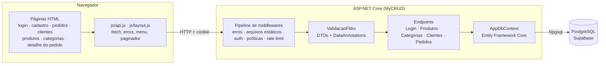
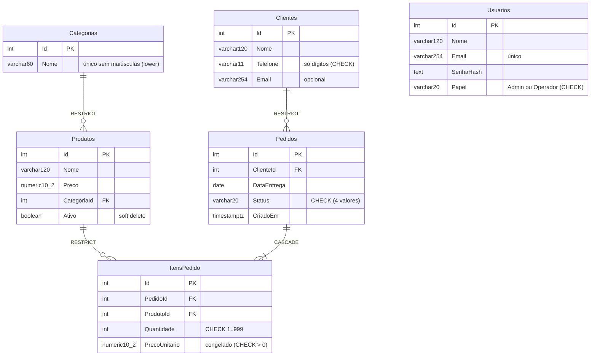
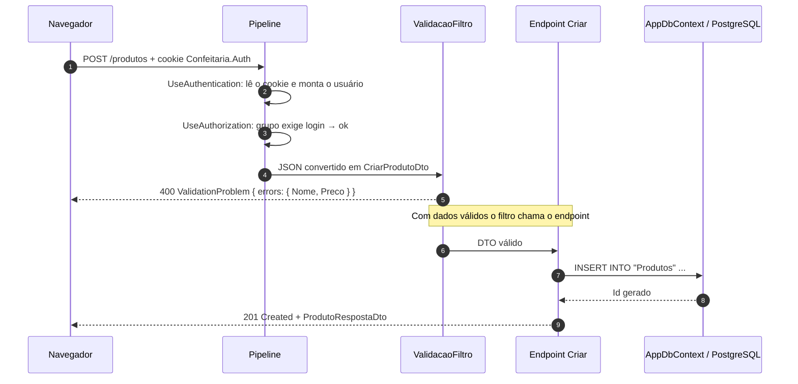

# Arquitetura

Visão geral de como o CRUD Confeitaria está organizado e do caminho que uma requisição percorre.

## Visão em camadas



| Camada | Responsabilidade | Arquivos |
| --- | --- | --- |
| Apresentação | Formulários, tabela, filtro, paginador, mensagens ao usuário | `wwwroot/*.html`, `wwwroot/js/api.js`, `wwwroot/js/layout.js`, `wwwroot/css/app.css` |
| Pipeline | Regras transversais: erros, autenticação, autorização (papéis), limite de tentativas | `Program.cs`, `Compartilhado/` |
| Endpoints | Recebem o DTO já validado, aplicam a regra de negócio, devolvem o status HTTP | `*/…Endpoints.cs` |
| Contrato | Formato de entrada e saída da API, com regras de validação | `*/…Dtos.cs` |
| Domínio / persistência | Entidades e mapeamento para tabelas | `*/<Entidade>.cs`, `Dados/AppDbContext.cs` |
| Banco | Armazenamento e integridade (tamanho, precisão, unicidade, FK, CHECK) | `Migrations/` → Supabase |

## Organização por funcionalidade

As pastas seguem **feature folders**: tudo sobre produtos fica em `Produtos/`, tudo sobre login em `Login/`.
Cada funcionalidade tem entidade, DTOs e endpoints, e uma linha `app.Map<X>Endpoints()` no `Program.cs`;
o mapeamento da entidade vai em `AppDbContext.OnModelCreating` e a mudança de schema vira uma migration.

```text
MyCRUD/
├── Program.cs               # Composição: serviços + ordem do pipeline
├── Compartilhado/           # Código usado por todas as funcionalidades
│   ├── ValidacaoFiltro.cs        # Valida DTOs antes do endpoint
│   ├── TratadorGlobalDeExcecoes.cs # Exceção → Problem Details (409 para único/FK)
│   ├── LimiteDeRequisicoes.cs    # Rate limiting do login
│   ├── Paginacao.cs              # ResultadoPaginado<T> + PaginarAsync
│   ├── ConsultaTexto.cs          # Padrão "contém" do ILIKE com curingas escapados
│   └── Politicas.cs              # Política SomenteAdmin (papel Admin)
├── Dados/AppDbContext.cs    # Sessão com o banco e regras de integridade
├── Login/                   # Usuário, papel, autenticação, cadastro
├── Produtos/                # Produtos (soft delete, filtro, paginação)
├── Categorias/              # Categorias (só Admin altera)
├── Clientes/                # Clientes (telefone só com dígitos)
├── Pedidos/                 # Pedidos, itens, status e transições
├── Migrations/              # Histórico versionado do schema
└── wwwroot/                 # Front-end estático
```

## Modelo de dados



Sem coluna de total no pedido: `Total = Σ(Quantidade × PrecoUnitario)` é calculado na consulta ([ADR-010](decisoes.md#adr-010)).
`(PedidoId, ProdutoId)` é único: um produto aparece no máximo uma vez por pedido.
`Usuarios` não se relaciona com as outras tabelas (o papel só controla o acesso).

## Listagens

Toda rota `GET /<recurso>` de lista recebe filtros e paginação pela query string e devolve o mesmo envelope
([ADR-011](decisoes.md#adr-011)):

```json
{ "itens": [ ... ], "pagina": 2, "tamanhoPagina": 20, "total": 57, "totalPaginas": 3 }
```

| Rota | Filtros | Ordem |
| --- | --- | --- |
| `GET /produtos` | `nome`, `categoriaId`, `situacao` (`Ativos` padrão · `Inativos` · `Todos`) | Id |
| `GET /categorias` | `nome` | Nome, Id |
| `GET /clientes` | `busca` (nome **ou** dígitos do telefone) | Nome, Id |
| `GET /pedidos` | `busca` (nome do cliente), `status`, `de`, `ate` | DataEntrega, Id |

Todas aceitam `pagina` (≥ 1, padrão 1) e `tamanho` (1–100, padrão 20); fora disso, 400.

## Caminho de uma requisição

Exemplo: `POST /produtos` com o corpo `{ "nome": "", "preco": -1, "categoriaId": 1 }`.



Se algo inesperado acontecer em qualquer etapa (banco fora do ar, bug), o `TratadorGlobalDeExcecoes` intercepta a exceção e devolve `500` em Problem Details, sem expor detalhes internos.

## Ordem do pipeline (`Program.cs`)

| Ordem | Middleware | Por que nessa posição |
| --- | --- | --- |
| 1 | `UseExceptionHandler` | Primeiro, para capturar exceções de tudo que vem depois |
| 2 | `UseStatusCodePages` | Dá corpo Problem Details a 401/404/429 vazios |
| 3 | `UseStaticFiles` | Serve o HTML sem passar por autenticação |
| 4 | `UseAuthentication` | Descobre **quem** é o usuário a partir do cookie |
| 5 | `UseAuthorization` | Decide **se** ele pode acessar a rota |
| 6 | `UseRateLimiter` | Conta tentativas nas rotas marcadas |

## Duas camadas de validação

| Onde | O que garante | Exemplo |
| --- | --- | --- |
| DTO (`[MaxLength]`, `[Range]`...) | Mensagem amigável, campo a campo, antes de tocar no banco | `"O nome deve ter no máximo 120 caracteres."` |
| Banco (`HasMaxLength`, índice único, FK, CHECK) | Integridade mesmo se a aplicação falhar ou houver concorrência | `varchar(120)`, `IX_Usuarios_Email`, `CK_Clientes_Telefone` |

Os dois lados usam as **mesmas constantes** (`Produto.NomeTamanhoMaximo`, `Usuario.EmailTamanhoMaximo`), então nunca divergem.

## Formato de erro

Toda resposta de erro segue a [RFC 9457 — Problem Details](https://www.rfc-editor.org/rfc/rfc9457):

```json
{
  "type": "https://tools.ietf.org/html/rfc9110#section-15.5.1",
  "title": "Dados inválidos.",
  "status": 400,
  "errors": {
    "Nome": ["Informe o nome."],
    "Preco": ["O preço deve ser maior que zero e menor que 100 milhões."]
  }
}
```

| Status | Quando |
| --- | --- |
| 400 | DTO ou filtro inválido, JSON malformado, ou referência inexistente (`errors.CategoriaId`, `errors.ClienteId`, `errors.Itens`) |
| 401 | Sem cookie de login, ou e-mail/senha incorretos |
| 403 | Usuário sem o papel exigido (Operador em rota de Admin) |
| 404 | Registro não encontrado |
| 409 | Conflito de estado: e-mail ou categoria duplicados, categoria com produtos, cliente com pedidos, transição de status inválida, violação de FK em corrida ("Registro em uso.") |
| 429 | Mais de 5 tentativas de login/cadastro por minuto no mesmo IP |
| 500 | Erro inesperado (detalhe técnico apenas em Development) |
