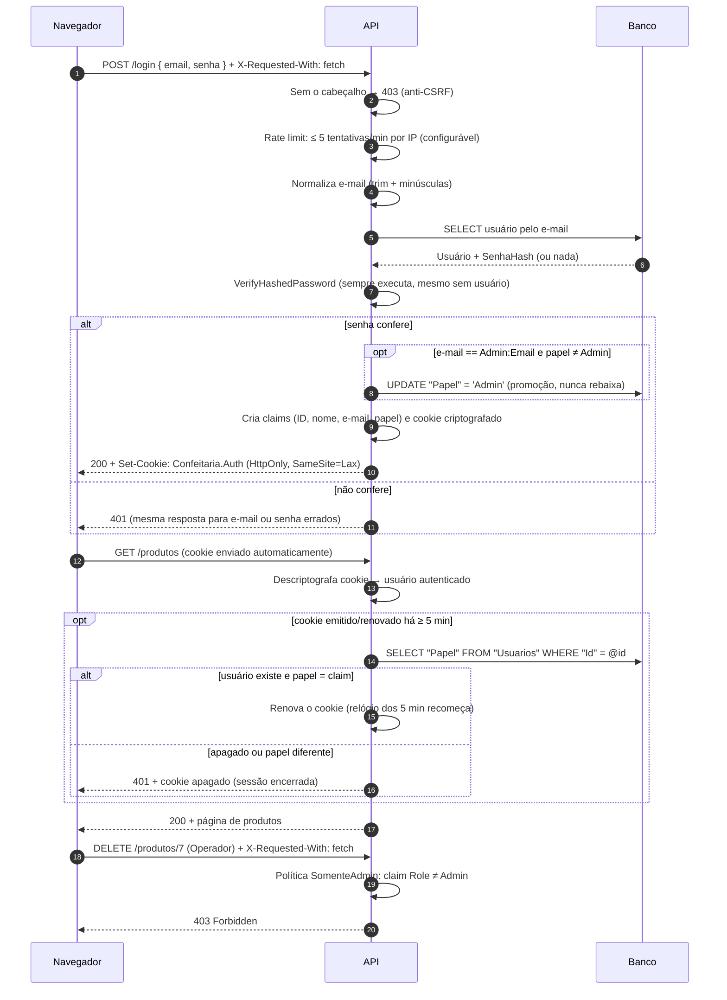

# Autenticação e segurança

Como o sistema identifica usuários e quais proteções existem em cada etapa.

## Conceitos

| Termo | Significado neste projeto |
| --- | --- |
| **Autenticação** | Provar quem você é (e-mail + senha → cookie) |
| **Autorização** | Decidir o que você pode fazer: toda rota de dados exige login (401) e algumas exigem o papel Admin (403) |
| **Papel** | Perfil de acesso do usuário: `Operador` (padrão) ou `Admin` |
| **Política** | Regra de autorização com nome, aplicada na rota (`Politicas.SomenteAdmin`) |
| **Hash de senha** | Transformação de mão única: dá para conferir a senha, não para recuperá-la |
| **Salt** | Valor aleatório misturado à senha antes do hash; senhas iguais geram hashes diferentes |
| **Claim** | Afirmação sobre o usuário guardada no cookie (ID, nome, e-mail, papel) |
| **Cookie de sessão** | Arquivo pequeno que o navegador reenvia em toda requisição ao mesmo site |

## Fluxo completo



## Papéis

| | Operador | Admin |
| --- | --- | --- |
| Listar e buscar tudo | ✅ | ✅ |
| Cadastrar/editar clientes e produtos | ✅ | ✅ |
| Criar pedido, confirmar, entregar, cancelar pedido **Aberto** | ✅ | ✅ |
| Desativar/reativar produto | ❌ 403 | ✅ |
| Cadastrar, renomear e excluir categoria | ❌ 403 | ✅ |
| Excluir cliente (sem pedidos) | ❌ 403 | ✅ |
| Cancelar pedido **Confirmado** | ❌ 403 | ✅ |

**Quem é Admin.** Não há tela para promover usuários. Todo usuário nasce `Operador` (inclusive os que já existiam antes da migration `AdicionarPapelUsuario`). No login, se o e-mail normalizado for igual ao de `Admin:Email`, o papel vira `Admin` e a promoção é registrada no log (só com o ID). Um Admin **nunca é rebaixado** automaticamente; rebaixar é SQL manual.

O cadastro (só Development) **recusa** o e-mail de `Admin:Email` com o mesmo `409 "E-mail já cadastrado."` de um e-mail duplicado (R42): ninguém consegue "chegar primeiro" ao e-mail do Admin, e a resposta não revela qual é. O usuário Admin vem do seed de demonstração (Fase 3) ou é cadastrado **antes** de configurar `Admin:Email`: cadastre-se, configure o e-mail, reinicie a API e entre.

```powershell
dotnet user-secrets set "Admin:Email" "seu-email@exemplo.com" --project MyCRUD/MyCRUD.csproj
```

Em produção, a variável de ambiente `Admin__Email`. Sem essa configuração a aplicação sobe, registra o aviso `Nenhum Admin configurado (Admin:Email).` e ninguém é promovido.

**Onde a regra é aplicada.**

| Camada | Como | Papel |
| --- | --- | --- |
| Rota | `.RequireAuthorization(Politicas.SomenteAdmin)` → 403 antes do endpoint | É a regra |
| Endpoint | `user.IsInRole("Admin")` só em `/pedidos/{id}/cancelar`, porque depende do status do pedido | É a regra |
| Tela | `body[data-papel]` + classe `.so-admin` escondem botões | Só conforto visual |
| `api.js` | `mensagemDeErro` traduz 403 em "Você não tem permissão para esta ação." | Mensagem |

**Papel no cookie e revalidação (R35).** O papel vai na claim `ClaimTypes.Role`, dentro do cookie criptografado (o usuário não consegue trocá-lo). `GET /login/eu` lê o papel do cookie, sem consultar o banco. A cada **5 minutos** o evento `OnValidatePrincipal` (`Login/ValidacaoDeSessao.cs`) confere o cookie no banco:

| Situação no banco | Resultado |
| --- | --- |
| Usuário existe e o papel é o da claim | Cookie renovado; mais 5 min sem consulta |
| Papel diferente (rebaixado **ou** promovido por SQL) | `RejectPrincipal` + `SignOut`: a requisição vira anônima (401) e o cookie é apagado |
| Usuário apagado | Idem |

**Por que encerrar em vez de trocar o papel no cookie (`ReplacePrincipal`)?** Mudança de papel é evento de segurança: forçar novo login é o caminho conservador. No novo login nome, e-mail e papel são relidos do banco, sem um segundo trecho de código montando claims. Promoção pelo `Admin:Email` acontece no próprio login, então não gera divergência. Cookies emitidos antes da Fase 2 (sem a claim de papel) são encerrados na primeira revalidação.

## Anti-CSRF por cabeçalho (R44)

Toda requisição `POST`, `PUT`, `PATCH` ou `DELETE` — inclusive `POST /login` e `POST /login/sair` — precisa do cabeçalho `X-Requested-With: fetch`. Sem ele: `403` `"Requisição sem o cabeçalho X-Requested-With."`, antes de abrir o cookie.

| Quem envia | Como |
| --- | --- |
| Telas | Função `api()` de `js/api.js` acrescenta o cabeçalho em todo `fetch` |
| PowerShell | `-Headers @{ 'X-Requested-With' = 'fetch' }` (exemplos no README) |
| Scalar | Aba *Headers* da requisição: `X-Requested-With` = `fetch` |
| Testes (Fase 3) | `HttpClient.DefaultRequestHeaders` |

Por que funciona: um `<form>` de outro site não acrescenta cabeçalhos, e um `fetch()` de outra origem com cabeçalho personalizado dispara preflight CORS, que esta API não libera. `SameSite=Lax` continua como primeira camada. Detalhes em [ADR-015](decisoes.md#adr-015).

## Cabeçalhos de segurança (R43)

`Compartilhado/CabecalhosDeSeguranca.cs`, primeiro middleware do pipeline, grava em toda resposta (inclusive erros):

| Cabeçalho | Valor | Evita |
| --- | --- | --- |
| `X-Content-Type-Options` | `nosniff` | Navegador executar como script um arquivo de outro tipo |
| `Referrer-Policy` | `strict-origin-when-cross-origin` | Vazar caminho e filtros (`?busca=...`) para outros sites |
| `X-Frame-Options` | `DENY` | Clickjacking (a página dentro de um `<iframe>`) |
| `Content-Security-Policy` | `default-src 'self'; script-src 'self'; style-src 'self'; img-src 'self' data:; frame-ancestors 'none'; base-uri 'self'; form-action 'self'` | Script injetado (XSS) rodar; estilo/script de outro domínio |
| `Strict-Transport-Security` (fora de Development) | padrão do `UseHsts` | Rebaixamento para HTTP |

`/scalar` e `/openapi` (só em Development) não recebem CSP: o Scalar carrega script de CDN e usa estilo inline.

## Proteções e o ataque que cada uma evita

| Proteção | Onde | Ataque evitado |
| --- | --- | --- |
| Hash PBKDF2 com salt (`PasswordHasher`) | `LoginEndpoints.Cadastrar` | Vazamento do banco revelar senhas |
| Rehash automático | `LoginEndpoints.Entrar` | Hashes antigos ficarem fracos com o tempo |
| Mesma resposta 401 para e-mail e senha | `LoginEndpoints.Entrar` | Descobrir quais e-mails existem (enumeração) |
| Hash fictício quando o e-mail não existe | `LoginEndpoints.HashFicticio` | Enumeração por **tempo** de resposta |
| Rate limiting 5/min por IP (configurável: `LimiteDeRequisicoes:TentativasPorMinuto`) | `LimiteDeRequisicoes` | Força bruta de senhas |
| Senha com no máximo 128 caracteres | `LoginDtos` | Gastar CPU com "senhas" gigantes |
| Cookie `HttpOnly` | `Program.cs` | Script malicioso ler o cookie (XSS) |
| Cookie `SameSite=Lax` | `Program.cs` | Outro site enviar POST em seu nome (CSRF) |
| Cabeçalho `X-Requested-With: fetch` obrigatório em escritas | `Compartilhado/ProtecaoCsrf.cs` | CSRF de subdomínio irmão ou navegador sem `SameSite` |
| CSP, `nosniff`, `X-Frame-Options`, `Referrer-Policy`, HSTS | `Compartilhado/CabecalhosDeSeguranca.cs`, `Program.cs` | XSS, clickjacking, *MIME sniffing*, vazamento de URL, rebaixamento para HTTP |
| Revalidação do cookie a cada 5 min | `Login/ValidacaoDeSessao.cs` | Admin rebaixado ou usuário apagado continuar agindo até o cookie expirar |
| Cookie `Secure` fora de Development | `Program.cs` | Cookie trafegar sem HTTPS |
| Cookie criptografado e assinado | ASP.NET Data Protection | Usuário alterar as próprias claims |
| `textContent` em vez de `innerHTML` | todas as telas (`layout.js`) | Nome de produto com `<script>` ser executado |
| E-mail normalizado + índice único | `Usuario.NormalizarEmail`, `AppDbContext` | Contas duplicadas `Ana@x.com` / `ana@x.com` |
| Cadastro só em Development | `LoginEndpoints` | Qualquer pessoa criar conta em produção |
| Cadastro sem campo de papel; Admin só por `Admin:Email` | `CriarUsuarioDto`, `LoginEndpoints.Entrar` | Alguém se cadastrar já como Admin |
| Cadastro recusa o e-mail de `Admin:Email` (409 genérico) | `LoginEndpoints.Cadastrar` | Alguém cadastrar o e-mail do Admin primeiro e virar Admin no login |
| Autor do pedido e da mudança de status vem do cookie | `PedidoEndpoints`, `Compartilhado/UsuarioLogado.cs` | Forjar quem criou/cancelou um pedido |
| Política `SomenteAdmin` nas rotas | `Compartilhado/Politicas.cs` | Operador chamar a rota pelo Scalar/PowerShell, sem o botão |
| Papel conferido dentro do `UPDATE` do cancelamento | `PedidoEndpoints.Cancelar` | Corrida "li Aberto, outro confirmou, cancelei Confirmado sem ser Admin" |
| Erros sem stack trace em produção | `TratadorGlobalDeExcecoes` | Vazar estrutura interna do sistema |
| Log de recusas sem `exception.Message` | `TratadorGlobalDeExcecoes` | Dado pessoal (e-mail, nome) parar no log via mensagem do PostgreSQL |
| RLS ligado sem policies em todas as tabelas | Migrations M1–M4 | Alguém com a chave `anon` do Supabase ler/gravar pela Data API |
| Conexão em User Secrets | `Program.cs` | Senha do banco publicada no GitHub |

## Por que não usamos Supabase Auth (e por que o RLS está ligado mesmo assim)

A aplicação conecta **diretamente** ao PostgreSQL do Supabase via Npgsql, usando o Supabase apenas como banco hospedado.
Supabase Auth e policies de Row Level Security pressupõem que o cliente acessa o banco pela Data API (REST) do Supabase com um token JWT.
Aqui, quem acessa o banco é sempre a API C#, e a autorização é feita nela.

Mesmo assim, o Supabase expõe o schema `public` na Data API para quem tiver a chave `anon` (pública por definição). Por isso as migrations ligam **RLS sem nenhuma policy** em todas as tabelas (R38): para `anon`/`authenticated` isso significa "nega tudo". A API conecta como dona das tabelas e o dono ignora RLS, então nada muda para ela. Ver [ADR-003](decisoes.md#adr-003).

## Limites conhecidos

- Mudança de papel ou exclusão de usuário leva até 5 min para encerrar a sessão (intervalo da revalidação).
- O Admin precisa existir antes: o cadastro recusa o e-mail de `Admin:Email` (seed da Fase 3, ou cadastrar antes de configurar o e-mail).
- Não há tela de gestão de usuários nem rebaixamento automático de Admin.
- O rate limit é por IP e fica em memória; reinicia com a aplicação e não é compartilhado entre servidores.
- Sem `UseForwardedHeaders`: atrás de proxy reverso todos os clientes dividem o limite do IP do proxy, e o redirecionamento HTTPS depende de `ASPNETCORE_HTTPS_PORT`. Confiar em `X-Forwarded-For` sem saber quem é o proxy deixaria o cliente inventar o próprio IP.
- RLS protege contra a chave `anon`, não contra a senha do banco: o dono das tabelas ignora RLS.
- Não há recuperação de senha nem confirmação de e-mail.
