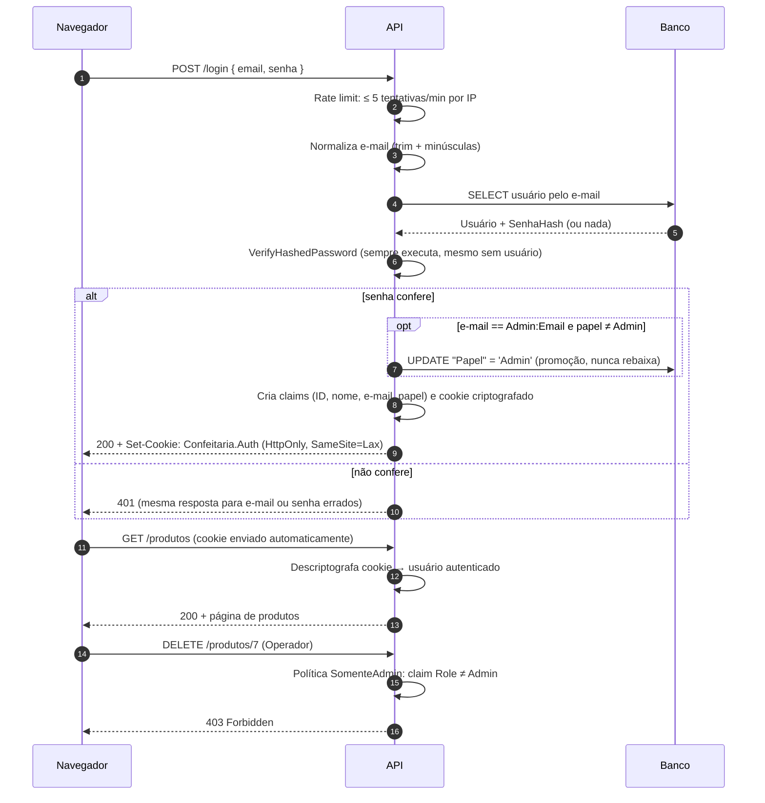

# Autenticação e segurança

Como o sistema identifica usuários e quais proteções existem em cada etapa.

## Conceitos

| Termo | Significado neste projeto |
| --- | --- |
| **Autenticação** | Provar quem você é (e-mail + senha → cookie) |
| **Autorização** | Decidir o que você pode fazer: toda rota de dados exige login (401) e algumas exigem o papel Admin (403) |
| **Papel** | Perfil de acesso do usuário: `Operador` (padrão) ou `Admin` |
| **Política** | Regra de autorização com nome, aplicada na rota (`Politicas.SomenteAdmin`) |
| **Hash de senha** | Transformação de mão única: dá para conferir a senha, não para recuperá-la |
| **Salt** | Valor aleatório misturado à senha antes do hash; senhas iguais geram hashes diferentes |
| **Claim** | Afirmação sobre o usuário guardada no cookie (ID, nome, e-mail, papel) |
| **Cookie de sessão** | Arquivo pequeno que o navegador reenvia em toda requisição ao mesmo site |

## Fluxo completo



## Papéis

| | Operador | Admin |
| --- | --- | --- |
| Listar e buscar tudo | ✅ | ✅ |
| Cadastrar/editar clientes e produtos | ✅ | ✅ |
| Criar pedido, confirmar, entregar, cancelar pedido **Aberto** | ✅ | ✅ |
| Desativar/reativar produto | ❌ 403 | ✅ |
| Cadastrar, renomear e excluir categoria | ❌ 403 | ✅ |
| Excluir cliente (sem pedidos) | ❌ 403 | ✅ |
| Cancelar pedido **Confirmado** | ❌ 403 | ✅ |

**Quem é Admin.** Não há tela para promover usuários. Todo usuário nasce `Operador` (inclusive os que já existiam antes da migration `AdicionarPapelUsuario`). No login, se o e-mail normalizado for igual ao de `Admin:Email`, o papel vira `Admin` e a promoção é registrada no log (só com o ID). Um Admin **nunca é rebaixado** automaticamente; rebaixar é SQL manual.

```powershell
dotnet user-secrets set "Admin:Email" "seu-email@exemplo.com" --project MyCRUD/MyCRUD.csproj
```

Em produção, a variável de ambiente `Admin__Email`. Sem essa configuração a aplicação sobe, registra o aviso `Nenhum Admin configurado (Admin:Email).` e ninguém é promovido.

**Onde a regra é aplicada.**

| Camada | Como | Papel |
| --- | --- | --- |
| Rota | `.RequireAuthorization(Politicas.SomenteAdmin)` → 403 antes do endpoint | É a regra |
| Endpoint | `user.IsInRole("Admin")` só em `/pedidos/{id}/cancelar`, porque depende do status do pedido | É a regra |
| Tela | `body[data-papel]` + classe `.so-admin` escondem botões | Só conforto visual |
| `api.js` | `mensagemDeErro` traduz 403 em "Você não tem permissão para esta ação." | Mensagem |

**Papel no cookie.** O papel vai na claim `ClaimTypes.Role`, dentro do cookie criptografado (o usuário não consegue trocá-lo). `GET /login/eu` lê o papel do cookie, sem consultar o banco. Consequência: uma promoção só vale depois que o usuário **sai e entra de novo** (o cookie vale até 2 h). Cookies emitidos antes da Fase 2 não têm a claim e valem como Operador.

## Proteções e o ataque que cada uma evita

| Proteção | Onde | Ataque evitado |
| --- | --- | --- |
| Hash PBKDF2 com salt (`PasswordHasher`) | `LoginEndpoints.Cadastrar` | Vazamento do banco revelar senhas |
| Rehash automático | `LoginEndpoints.Entrar` | Hashes antigos ficarem fracos com o tempo |
| Mesma resposta 401 para e-mail e senha | `LoginEndpoints.Entrar` | Descobrir quais e-mails existem (enumeração) |
| Hash fictício quando o e-mail não existe | `LoginEndpoints.HashFicticio` | Enumeração por **tempo** de resposta |
| Rate limiting 5/min por IP | `LimiteDeRequisicoes` | Força bruta de senhas |
| Senha com no máximo 128 caracteres | `LoginDtos` | Gastar CPU com "senhas" gigantes |
| Cookie `HttpOnly` | `Program.cs` | Script malicioso ler o cookie (XSS) |
| Cookie `SameSite=Lax` | `Program.cs` | Outro site enviar POST em seu nome (CSRF) |
| Cookie `Secure` fora de Development | `Program.cs` | Cookie trafegar sem HTTPS |
| Cookie criptografado e assinado | ASP.NET Data Protection | Usuário alterar as próprias claims |
| `textContent` em vez de `innerHTML` | todas as telas (`layout.js`) | Nome de produto com `<script>` ser executado |
| E-mail normalizado + índice único | `Usuario.NormalizarEmail`, `AppDbContext` | Contas duplicadas `Ana@x.com` / `ana@x.com` |
| Cadastro só em Development | `LoginEndpoints` | Qualquer pessoa criar conta em produção |
| Cadastro sem campo de papel; Admin só por `Admin:Email` | `CriarUsuarioDto`, `LoginEndpoints.Entrar` | Alguém se cadastrar já como Admin |
| Política `SomenteAdmin` nas rotas | `Compartilhado/Politicas.cs` | Operador chamar a rota pelo Scalar/PowerShell, sem o botão |
| Papel conferido dentro do `UPDATE` do cancelamento | `PedidoEndpoints.Cancelar` | Corrida "li Aberto, outro confirmou, cancelei Confirmado sem ser Admin" |
| Erros sem stack trace em produção | `TratadorGlobalDeExcecoes` | Vazar estrutura interna do sistema |
| Conexão em User Secrets | `Program.cs` | Senha do banco publicada no GitHub |

## Por que não usamos Supabase Auth

A aplicação conecta **diretamente** ao PostgreSQL do Supabase via Npgsql, usando o Supabase apenas como banco hospedado.
Supabase Auth e Row Level Security pressupõem que o cliente acessa o banco pela API REST do Supabase com um token JWT.
Aqui, quem acessa o banco é sempre a API C#, e a autorização é feita nela. Ver [decisões](decisoes.md#adr-003).

## Limites conhecidos

- Mudança de papel só vale no próximo login (papel guardado no cookie).
- Em Development, quem se cadastrar com o e-mail de `Admin:Email` vira Admin no primeiro login.
- Não há tela de gestão de usuários nem rebaixamento automático de Admin.
- O rate limit é por IP e fica em memória; reinicia com a aplicação e não é compartilhado entre servidores.
- Não há recuperação de senha nem confirmação de e-mail.
