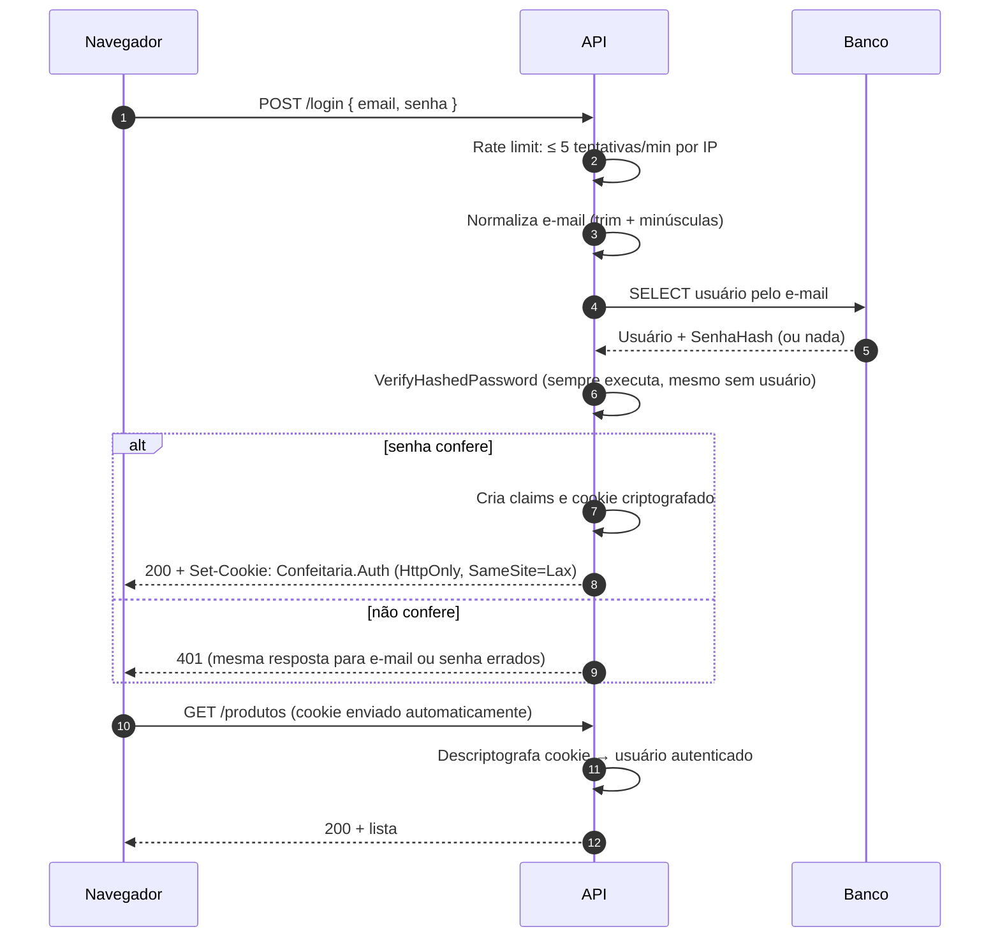

# Autenticação e segurança

Como o sistema identifica usuários e quais proteções existem em cada etapa.

## Conceitos

| Termo | Significado neste projeto |
| --- | --- |
| **Autenticação** | Provar quem você é (e-mail + senha → cookie) |
| **Autorização** | Decidir o que você pode fazer (rotas de produtos exigem login) |
| **Hash de senha** | Transformação de mão única: dá para conferir a senha, não para recuperá-la |
| **Salt** | Valor aleatório misturado à senha antes do hash; senhas iguais geram hashes diferentes |
| **Claim** | Afirmação sobre o usuário guardada no cookie (ID, nome, e-mail) |
| **Cookie de sessão** | Arquivo pequeno que o navegador reenvia em toda requisição ao mesmo site |

## Fluxo completo

## Proteções e o ataque que cada uma evita

| Proteção | Onde | Ataque evitado |
| --- | --- | --- |
| Hash PBKDF2 com salt (`PasswordHasher`) | `LoginEndpoints.Cadastrar` | Vazamento do banco revelar senhas |
| Rehash automático | `LoginEndpoints.Entrar` | Hashes antigos ficarem fracos com o tempo |
| Mesma resposta 401 para e-mail e senha | `LoginEndpoints.Entrar` | Descobrir quais e-mails existem (enumeração) |
| Hash fictício quando o e-mail não existe | `LoginEndpoints.HashFicticio` | Enumeração por **tempo** de resposta |
| Rate limiting 5/min por IP | `LimiteDeRequisicoes` | Força bruta de senhas |
| Senha com no máximo 128 caracteres | `LoginDtos` | Gastar CPU com "senhas" gigantes |
| Cookie `HttpOnly` | `Program.cs` | Script malicioso ler o cookie (XSS) |
| Cookie `SameSite=Lax` | `Program.cs` | Outro site enviar POST em seu nome (CSRF) |
| Cookie `Secure` fora de Development | `Program.cs` | Cookie trafegar sem HTTPS |
| Cookie criptografado e assinado | ASP.NET Data Protection | Usuário alterar as próprias claims |
| `textContent` em vez de `innerHTML` | `produtos.html` | Nome de produto com `<script>` ser executado |
| E-mail normalizado + índice único | `Usuario.NormalizarEmail`, `AppDbContext` | Contas duplicadas `Ana@x.com` / `ana@x.com` |
| Cadastro só em Development | `LoginEndpoints` | Qualquer pessoa criar conta em produção |
| Erros sem stack trace em produção | `TratadorGlobalDeExcecoes` | Vazar estrutura interna do sistema |
| Conexão em User Secrets | `Program.cs` | Senha do banco publicada no GitHub |

## Por que não usamos Supabase Auth

A aplicação conecta **diretamente** ao PostgreSQL do Supabase via Npgsql, usando o Supabase apenas como banco hospedado.
Supabase Auth e Row Level Security pressupõem que o cliente acessa o banco pela API REST do Supabase com um token JWT.
Aqui, quem acessa o banco é sempre a API C#, e a autorização é feita nela. Ver [decisões](decisoes.md#adr-003).

## Limites conhecidos

- Não há papéis (admin/usuário): todo usuário logado pode excluir produtos.
- O rate limit é por IP e fica em memória; reinicia com a aplicação e não é compartilhado entre servidores.
- Não há recuperação de senha nem confirmação de e-mail.
