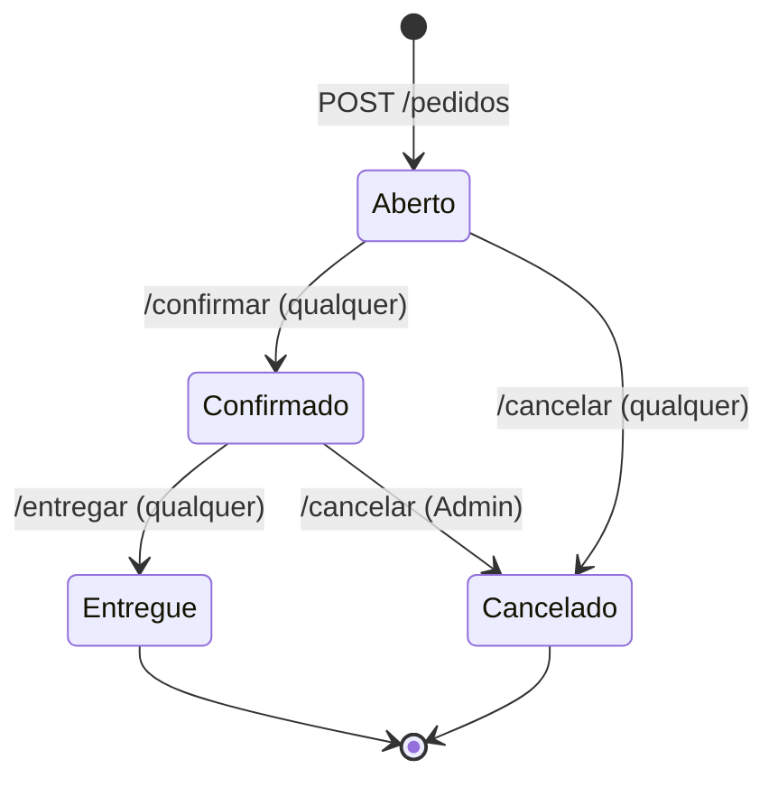

# Fases 2–4 — telas, contrato e divisão de trabalho

> **Status: proposta para aprovação do dono.** Nenhuma linha de C# foi escrita.
> Depois de aprovado, este documento é o contrato: agentes e integrador seguem os nomes,
> tipos, rotas e regras daqui. Mudança de contrato = editar este arquivo primeiro.

Ordem do documento: **telas primeiro**, regras derivadas delas, depois o contrato técnico.

| Seção | Conteúdo |
| --- | --- |
| [0](#0-decisões-e-dúvidas) | Decisões do arquiteto e dúvidas que só o dono resolve |
| [1](#1-telas) | Padrão de tela e as 5 telas (protótipos em `MyCRUD/wwwroot/prototipos/`) |
| [2](#2-fase-2--domínio) | Fase 2: entidades, DTOs, rotas, regras R1–R37, status, migrations, riscos |
| [3](#3-divisão-de-trabalho-fase-2) | Divisão de trabalho Fase 2 (A2–A5 + integrador) |
| [4](#4-fase-3--qualidade) | Fase 3: testes de integração, CI com Testcontainers, seed de demo |
| [5](#5-fase-4--documentação-e-apresentação) | Fase 4: documentação e apresentação |

---

## 0. Decisões e dúvidas

### Decisões tomadas pelo arquiteto (vetáveis na revisão)

| # | Decisão | Motivo (1 linha) |
| --- | --- | --- |
| D1 | **Paginação + filtros puxados para a Fase 2** | Barra de filtro e paginador fazem parte do padrão de tela; definir `Pagina<T>` agora evita quebrar `GET /produtos` duas vezes. |
| D2 | Mudança de status por **rotas de ação** (`/confirmar`, `/entregar`, `/cancelar`) em vez de `PATCH status` | Autorização por rota (cancelar Confirmado = Admin) e erro 409 claro por transição. |
| D3 | `PUT /produtos/{id}` **deixa de receber `Ativo`**; desativar = `DELETE`, reativar = `POST /produtos/{id}/reativar` (ambos Admin) | Só Admin desativa; com `Ativo` no PUT, um Operador desativaria pelo formulário. |
| D4 | "Data" do pedido = **`DataEntrega`** (`date`, informada) + **`CriadoEm`** (`timestamptz`, automática) | Confeitaria trabalha por data de entrega; `CriadoEm` registra quando o preço foi congelado. |
| D5 | Pedido **imutável após criado** (cliente, data, itens). Corrigir = cancelar e criar outro | Mantém a Fase 2 pequena; editar itens exige recalcular preço congelado. |
| D6 | Unicidade do nome de categoria **sem diferenciar maiúsculas**, garantida por índice `lower("Nome")` | "Bolos" e "bolos" seriam a mesma categoria para o usuário. |
| D7 | Telefone salvo **só com dígitos** (10 ou 11), tela aceita máscara | Busca por telefone funciona independentemente da formatação digitada. |
| D8 | Admin **nunca é rebaixado** automaticamente | Trocar `Admin:Email` não deve tirar acesso de alguém sem aviso; rebaixar = SQL manual. |
| D9 | **4 migrations**, uma por agente, aplicadas em ordem M1→M4 | Cada uma revisável e reversível isoladamente. |
| D10 | Enums (`Papel`, `StatusPedido`) como **texto** no JSON e no banco (`varchar` + `CHECK`) | Legível no Supabase e no Scalar; o CHECK garante valores válidos. |
| D11 | Tela inicial após login = **Pedidos** | É a tela de uso diário; produtos/categorias são cadastro. |
| D12 | Cliente com pedidos **não pode ser excluído** (409); sem soft delete de cliente | Preserva histórico sem adicionar campo não aprovado. |

### Dúvidas que só o dono resolve

| # | Pergunta | Proposta padrão se não houver resposta |
| --- | --- | --- |
| Q1 | Cancelar pedido é só Admin, ou Operador também pode cancelar pedido **Aberto**? | **Decidido (dono):** Operador cancela Aberto; cancelar Confirmado é só Admin. |
| Q2 | Pedido pode ter data de entrega **no passado** (registrar venda já feita)? | **Decidido (dono):** não; só o seed de demo grava datas passadas. |
| Q3 | Telefone deve ser **único** entre clientes? | **Decidido (dono):** não único. |
| Q4 | Quem roda `dotnet ef migrations add`? O ambiente dos agentes não tem .NET. | **Decidido (dono):** integrador escreve migration + snapshot à mão; CI valida com `has-pending-model-changes`; se divergir, dono roda `dotnet ef` local. |
| Q5 | Protótipos (`wwwroot/prototipos/`) saem do repositório na Fase 4? | **Padrão adotado:** sim, na Fase 4; screenshots ficam na documentação. |

---

## 1. Telas

### 1.1 Padrão único

Todas as telas internas usam o mesmo esqueleto, o mesmo CSS (`css/app.css`) e o mesmo cabeçalho (`js/layout.js`):

```text
┌─ faixa PROTÓTIPO (só nos protótipos) ───────────────────────────────────────┐
├─ cabeçalho: Confeitaria · Pedidos Clientes Produtos Categorias · Nome [PAPEL] Sair ┤
│ Título  subtítulo                                                            │
│ [mensagem de sucesso/erro]                                                   │
│ ┌ 1. barra de filtro ─────────────────────┐  ┌ 3. formulário ──────────┐    │
│ │ campos · Filtrar · Limpar                │  │ Novo X / Editar X n     │    │
│ └──────────────────────────────────────────┘  │ campos                  │    │
│ ┌ 2. lista ───────────────────────────────┐  │ 4. ações: Salvar Cancelar│    │
│ │ tabela · ações por linha (Editar, …)     │  └─────────────────────────┘    │
│ │ paginador: "1–20 de 57"  ‹ 1 2 3 ›       │                                 │
│ └──────────────────────────────────────────┘                                 │
└──────────────────────────────────────────────────────────────────────────────┘
```

- ≥ 960 px: lista à esquerda, formulário fixo à direita. < 960 px: empilha na ordem filtro → lista → formulário → ações.
- Botões só de Admin têm a classe `so-admin` e somem para Operador (`body[data-papel]`). **Isso é conforto visual; a API devolve 403** (R2).
- Mensagens: `mostrarMensagem(el, texto, "sucesso"|"erro"|"info")`. Erros da API: `mensagemDeErro` (api.js).
- Texto vindo da API entra só por `textContent` (helpers `criarCelula`, `criarBotao`, `criarSelo`).
- Filtros → query string via `montarQuery`; resposta paginada → `montarPaginador`.

Arquivos comuns (já criados nesta tarefa, donos: integrador):

| Arquivo | Conteúdo |
| --- | --- |
| `MyCRUD/wwwroot/css/app.css` | Paleta do login (`#793e29`, `#fff5ef`), grid da página, barra de filtro, tabela, paginador, formulário, botões, selos de status, `.so-admin` |
| `MyCRUD/wwwroot/js/layout.js` | `iniciarLayout({ ativo })` (chama `exigirLogin`, injeta menu + usuário + papel + Sair, define `body[data-papel]`), `formatarMoeda`, `formatarData`, `formatarDataHora`, `formatarTelefone`, `criarCelula`, `criarBotao`, `criarSelo`, `mostrarMensagem`, `montarPaginador`, `montarQuery` |

Ordem dos scripts em toda tela real: `/js/api.js` → `/js/layout.js` → script da página.

Screenshots 1280 px dos protótipos: `doc-build/img/proto_<nome>.png` (fora do repositório).

### 1.2 Telas

#### T1 — Produtos (`produtos.html`) · protótipo `prototipos/produtos.html` (visão Admin, editando)

| Bloco | Conteúdo |
| --- | --- |
| Filtro | Nome (contém), Categoria (select, "Todas"), Situação (Ativos · Inativos · Todos; padrão **Ativos**) |
| Lista | ID · Nome · Categoria (nome) · Preço · Situação (selo) · ações: **Editar**; **Desativar** (Admin, se ativo) / **Reativar** (Admin, se inativo). Linha inativa em cinza; linha em edição destacada. Ordem: Id. |
| Formulário | Nome · Preço · Categoria (select). Título "Cadastrar produto" / "Editar produto N". Sem checkbox Ativo (D3). |
| Ações | Cadastrar / Salvar alterações · Cancelar (só em edição) |
| Regras derivadas | R4–R6, R12–R17 |

#### T2 — Categorias (`categorias.html`) · protótipo `prototipos/categorias.html` (visão Admin)

| Bloco | Conteúdo |
| --- | --- |
| Filtro | Nome (contém) |
| Lista | ID · Nome · Produtos (quantidade) · ações Admin: **Editar**, **Excluir** (desabilitado com dica quando há produtos). Ordem: Nome. |
| Formulário | Nome (até 60). Para Operador: formulário oculto e aviso "Apenas Admin cadastra, edita ou exclui categorias." |
| Ações | Cadastrar / Salvar · Cancelar |
| Regras derivadas | R8–R11 |

#### T3 — Clientes (`clientes.html`) · protótipo `prototipos/clientes.html` (visão Operador)

| Bloco | Conteúdo |
| --- | --- |
| Filtro | Nome ou telefone (um campo, contém) |
| Lista | ID · Nome · Telefone (formatado) · E-mail ("—" se vazio) · ações: **Editar**; **Excluir** (Admin). Ordem: Nome. |
| Formulário | Nome · Telefone (aceita máscara) · E-mail (opcional) |
| Ações | Cadastrar / Salvar · Cancelar |
| Regras derivadas | R18–R20 |

#### T4 — Pedidos (`pedidos.html`) · protótipo `prototipos/pedidos.html` (visão Operador)

| Bloco | Conteúdo |
| --- | --- |
| Filtro | Cliente (nome contém) · Status (Todos/Aberto/Confirmado/Entregue/Cancelado) · Entrega de · até |
| Lista | Nº · Cliente · Entrega · Itens (soma das quantidades) · Total · Status (selo) · ação **Abrir** → `pedido-detalhe.html?id=N`. Ordem: DataEntrega, Id. |
| Formulário "Novo pedido" | Cliente (select, `GET /clientes?tamanho=100`) · Data de entrega (`min` = hoje) · Itens: linhas *produto ativo (select com preço) + quantidade + remover*, botão "+ Adicionar item" · **Total estimado** (preço atual; aviso "o valor fica congelado ao criar") |
| Ações | Criar pedido · Limpar. Sucesso → abre o detalhe do pedido criado. |
| Regras derivadas | R21–R27 |

#### T5 — Detalhe do pedido (`pedido-detalhe.html?id=N`) · protótipo `prototipos/pedido-detalhe.html` (visão Admin)

Mesmo esqueleto, largura total (`.pagina-larga`): o lugar da barra de filtro mostra o **resumo**, a lista mostra os **itens**, as **ações** são as transições.

| Bloco | Conteúdo |
| --- | --- |
| Resumo | Nº + selo de status · Cliente · Telefone · Entrega · Itens · Total · linha do tempo Aberto → Confirmado → Entregue |
| Lista | Produto · Qtd. · Preço unit. (congelado) · Subtotal · rodapé Total. "Preços fixados em <CriadoEm>". |
| Formulário | Nenhum (pedido imutável, D5) |
| Ações | Só as válidas para o status: Aberto → **Confirmar**, **Cancelar** (qualquer); Confirmado → **Marcar como entregue**, **Cancelar** (Admin); Entregue/Cancelado → nenhuma ("Pedido finalizado"). Voltar aos pedidos. |
| Regras derivadas | R25, R28–R31 |

---

## 2. Fase 2 — domínio

### 2.1 Convenções comuns

**Envelope de listagem** (todas as rotas `GET /<recurso>` de lista):

```json
{ "itens": [ ... ], "pagina": 2, "tamanhoPagina": 20, "total": 57, "totalPaginas": 3 }
```

**Contrato C# compartilhado** — `MyCRUD/Compartilhado/Paginacao.cs` (criado pelo integrador no passo 0):

| Membro | Assinatura |
| --- | --- |
| Envelope | `public record Pagina<T>(IReadOnlyList<T> Itens, int Pagina, int TamanhoPagina, int Total)` + propriedade calculada `int TotalPaginas` (0 quando `Total == 0`) |
| Constantes | `public static class Paginacao { public const int TamanhoPadrao = 20; public const int TamanhoMaximo = 100; }` |
| Extensão | `Task<Pagina<T>> PaginarAsync<T>(this IQueryable<T> consulta, int pagina, int tamanho, CancellationToken ct = default)` — faz `CountAsync` + `Skip/Take`; a consulta **já deve vir ordenada** |

**Filtros** são records ligados por `[AsParameters]` e validados com `.ComValidacao<FiltroX>()` (o `ValidacaoFiltro` já encontra o argumento pelo tipo). Todo filtro tem:

```text
[property: Range(1, int.MaxValue)]                    int Pagina  = 1
[property: Range(1, Paginacao.TamanhoMaximo)]         int Tamanho = Paginacao.TamanhoPadrao
```

**JSON**: `JsonStringEnumConverter` global (passo 0) → enums trafegam como `"Aberto"`, `"Admin"`. Datas `DateOnly` como `"2026-11-20"`; `DateTime` UTC como `"2026-11-17T14:05:00Z"`.

**Autorização**: grupo com `.RequireAuthorization()`; rotas de Admin com `.RequireAuthorization(Politicas.SomenteAdmin)` + `.ProducesProblem(403)`.

**Erros de regra que dependem do banco** (cliente/categoria/produto inexistente referenciado): `400 ValidationProblem` com a chave do campo, mesmo formato do `ValidacaoFiltro`. **Conflito de estado** (duplicado, em uso, transição inválida): `409 Problem` com `title` legível em pt-BR.

### 2.2 Entidades

Tipos de banco: PostgreSQL via Npgsql. "PK identity" = `integer GENERATED BY DEFAULT AS IDENTITY`.

#### Categoria — tabela `Categorias` (nova, A2) · `MyCRUD.Categorias.Categoria`

| Campo | Tipo C# | Tipo banco | Constraint |
| --- | --- | --- | --- |
| `Id` | `int` | `integer` | PK identity |
| `Nome` | `string` | `varchar(60)` | NOT NULL; `UNIQUE (lower("Nome"))` → índice `IX_Categorias_Nome_Minusculo` (SQL na migration) |

Constante: `Categoria.NomeTamanhoMaximo = 60`.

#### Produto — tabela `Produtos` (alterada, A5) · `MyCRUD.Produtos.Produto`

| Campo | Tipo C# | Tipo banco | Constraint |
| --- | --- | --- | --- |
| `Id` | `int` | `integer` | PK identity (sem mudança) |
| `Nome` | `string` | `varchar(120)` | NOT NULL (sem mudança) |
| `Preco` | `decimal` | `numeric(10,2)` | NOT NULL (sem mudança) |
| `CategoriaId` | `int` | `integer` | NOT NULL; **FK `FK_Produtos_Categorias_CategoriaId` → `Categorias.Id` ON DELETE RESTRICT**; índice `IX_Produtos_CategoriaId` |
| `Categoria` | `Categoria?` | — | navegação (nova) |
| `Ativo` | `bool` | `boolean` | NOT NULL (sem mudança); só muda por DELETE/reativar |

#### Cliente — tabela `Clientes` (nova, A3) · `MyCRUD.Clientes.Cliente`

| Campo | Tipo C# | Tipo banco | Constraint |
| --- | --- | --- | --- |
| `Id` | `int` | `integer` | PK identity |
| `Nome` | `string` | `varchar(120)` | NOT NULL; índice `IX_Clientes_Nome` (ordenação) |
| `Telefone` | `string` | `varchar(11)` | NOT NULL; `CHECK ("Telefone" ~ '^[0-9]{10,11}$')` → `CK_Clientes_Telefone` |
| `Email` | `string?` | `varchar(254)` | NULL |

Constantes: `NomeTamanhoMaximo = 120`, `TelefoneTamanhoMaximo = 11`, `TelefoneEntradaTamanhoMaximo = 20` (com máscara), `EmailTamanhoMaximo = Usuario.EmailTamanhoMaximo`.

#### Pedido — tabela `Pedidos` (nova, A4) · `MyCRUD.Pedidos.Pedido`

| Campo | Tipo C# | Tipo banco | Constraint |
| --- | --- | --- | --- |
| `Id` | `int` | `integer` | PK identity |
| `ClienteId` | `int` | `integer` | NOT NULL; FK → `Clientes.Id` ON DELETE RESTRICT; índice |
| `Cliente` | `Cliente?` | — | navegação |
| `DataEntrega` | `DateOnly` | `date` | NOT NULL; índice `IX_Pedidos_DataEntrega` |
| `Status` | `StatusPedido` | `varchar(20)` | NOT NULL; `HasConversion<string>()`; `CHECK ("Status" IN ('Aberto','Confirmado','Entregue','Cancelado'))` → `CK_Pedidos_Status` |
| `CriadoEm` | `DateTime` (UTC) | `timestamp with time zone` | NOT NULL |
| `Itens` | `List<ItemPedido>` | — | navegação 1:N |

Constante: `Pedido.ItensMaximo = 50`. Enum `MyCRUD.Pedidos.StatusPedido { Aberto, Confirmado, Entregue, Cancelado }`. **Sem coluna de total** (R25).

#### ItemPedido — tabela `ItensPedido` (nova, A4) · `MyCRUD.Pedidos.ItemPedido`

| Campo | Tipo C# | Tipo banco | Constraint |
| --- | --- | --- | --- |
| `Id` | `int` | `integer` | PK identity |
| `PedidoId` | `int` | `integer` | NOT NULL; FK → `Pedidos.Id` ON DELETE CASCADE |
| `ProdutoId` | `int` | `integer` | NOT NULL; FK → `Produtos.Id` ON DELETE RESTRICT; índice `IX_ItensPedido_ProdutoId` |
| `Produto` | `Produto?` | — | navegação |
| `Quantidade` | `int` | `integer` | NOT NULL; `CHECK ("Quantidade" BETWEEN 1 AND 999)` → `CK_ItensPedido_Quantidade` |
| `PrecoUnitario` | `decimal` | `numeric(10,2)` | NOT NULL; `CHECK ("PrecoUnitario" > 0)` → `CK_ItensPedido_PrecoUnitario` |
| — | — | — | `UNIQUE ("PedidoId", "ProdutoId")` → `IX_ItensPedido_PedidoId_ProdutoId` |

Constante: `ItemPedido.QuantidadeMaxima = 999`.

#### Usuario — tabela `Usuarios` (alterada, A5) · `MyCRUD.Login.Usuario`

| Campo | Tipo C# | Tipo banco | Constraint |
| --- | --- | --- | --- |
| `Papel` (novo) | `Papel` | `varchar(20)` | NOT NULL DEFAULT `'Operador'`; `HasConversion<string>()`; `CHECK ("Papel" IN ('Admin','Operador'))` → `CK_Usuarios_Papel` |

Enum `MyCRUD.Login.Papel { Operador, Admin }` (Operador = 0 = padrão).

### 2.3 DTOs

Atributos sempre com `[property: ...]` e mensagens pt-BR; tamanhos pelas constantes das entidades.

| DTO | Campos | Validação |
| --- | --- | --- |
| **Categorias** (`Categorias/CategoriaDtos.cs`) | | |
| `CriarCategoriaDto` | `string Nome` | Required, MaxLength(60) |
| `AtualizarCategoriaDto` | `string Nome` | Required, MaxLength(60) |
| `CategoriaRespostaDto` | `int Id, string Nome, int QuantidadeProdutos` | — |
| `FiltroCategorias` | `string? Nome, int Pagina = 1, int Tamanho = 20` | paginação |
| **Clientes** (`Clientes/ClienteDtos.cs`) | | |
| `CriarClienteDto` | `string Nome, string Telefone, string? Email` | Nome Required/MaxLength(120); Telefone Required/MaxLength(20); Email EmailAddress/MaxLength(254) — **vazio deve ir como `null`** (o front converte) |
| `AtualizarClienteDto` | idem | idem |
| `ClienteRespostaDto` | `int Id, string Nome, string Telefone, string? Email` | Telefone só dígitos |
| `FiltroClientes` | `string? Busca, int Pagina = 1, int Tamanho = 20` | paginação |
| **Produtos** (`Produtos/ProdutoDtos.cs`) | | |
| `CriarProdutoDto` | `string Nome, decimal Preco, int CategoriaId` | sem mudança |
| `AtualizarProdutoDto` | `string Nome, decimal Preco, int CategoriaId` | **remove `Ativo`** (D3) |
| `ProdutoRespostaDto` | `int Id, string Nome, decimal Preco, int CategoriaId, string CategoriaNome, bool Ativo` | **+ `CategoriaNome`** |
| `FiltroProdutos` | `string? Nome, int? CategoriaId, SituacaoProduto Situacao = SituacaoProduto.Ativos, int Pagina = 1, int Tamanho = 20` | enum `SituacaoProduto { Ativos, Inativos, Todos }` no mesmo arquivo |
| **Pedidos** (`Pedidos/PedidoDtos.cs`) | | |
| `CriarPedidoDto : IValidatableObject` | `int ClienteId, DateOnly DataEntrega, List<CriarItemPedidoDto> Itens` | ClienteId Range(1,∞); Itens Required, MinLength(1), MaxLength(50); `Validate()` valida **cada item** (o `Validator` não desce em listas) e ProdutoId repetido, com chaves `Itens[i].Quantidade` |
| `CriarItemPedidoDto` | `int ProdutoId, int Quantidade` | validado por `CriarPedidoDto.Validate`: ProdutoId ≥ 1; Quantidade 1–999. **Sem preço** (R23) |
| `PedidoResumoDto` | `int Id, int ClienteId, string ClienteNome, DateOnly DataEntrega, StatusPedido Status, int QuantidadeItens, decimal Total` | `QuantidadeItens` = soma das quantidades |
| `PedidoDetalheDto` | `int Id, int ClienteId, string ClienteNome, string ClienteTelefone, DateOnly DataEntrega, StatusPedido Status, DateTime CriadoEm, IReadOnlyList<ItemPedidoRespostaDto> Itens, decimal Total` | — |
| `ItemPedidoRespostaDto` | `int ProdutoId, string ProdutoNome, int Quantidade, decimal PrecoUnitario, decimal Subtotal` | — |
| `FiltroPedidos : IValidatableObject` | `string? Busca, StatusPedido? Status, DateOnly? De, DateOnly? Ate, int Pagina = 1, int Tamanho = 20` | `De > Ate` → erro em `Ate` |
| **Login** (`Login/LoginDtos.cs`) | | |
| `UsuarioRespostaDto` | `int Id, string Nome, string Email, Papel Papel` | **+ `Papel`** |
| `CriarUsuarioDto` | sem mudança — **não** recebe papel (R37) | |

### 2.4 Rotas

Todas exigem login (401 sem cookie). "Admin" = política `SomenteAdmin` (403 para Operador). 400 = validação; 404 = id inexistente.

| Método | Caminho | Papel | Sucesso | Erros |
| --- | --- | --- | --- | --- |
| **Categorias** | | | | |
| GET | `/categorias?nome=&pagina=&tamanho=` | qualquer | 200 `Pagina<CategoriaRespostaDto>` | 400 |
| GET | `/categorias/{id}` | qualquer | 200 `CategoriaRespostaDto` | 404 |
| POST | `/categorias` | Admin | 201 + `Location` | 400, 403, 409 nome duplicado |
| PUT | `/categorias/{id}` | Admin | 200 | 400, 403, 404, 409 nome duplicado |
| DELETE | `/categorias/{id}` | Admin | 204 | 403, 404, 409 possui produtos |
| **Produtos** | | | | |
| GET | `/produtos?nome=&categoriaId=&situacao=&pagina=&tamanho=` | qualquer | 200 `Pagina<ProdutoRespostaDto>` (**era lista**) | 400 |
| GET | `/produtos/{id}` | qualquer | 200 | 404 |
| POST | `/produtos` | qualquer | 201 | 400 (inclui categoria inexistente) |
| PUT | `/produtos/{id}` | qualquer | 200 | 400, 404 |
| DELETE | `/produtos/{id}` | Admin | 204 (**desativa**, idempotente) | 403, 404 |
| POST | `/produtos/{id}/reativar` | Admin | 204 (idempotente) | 403, 404 |
| **Clientes** | | | | |
| GET | `/clientes?busca=&pagina=&tamanho=` | qualquer | 200 `Pagina<ClienteRespostaDto>` | 400 |
| GET | `/clientes/{id}` | qualquer | 200 | 404 |
| POST | `/clientes` | qualquer | 201 | 400 |
| PUT | `/clientes/{id}` | qualquer | 200 | 400, 404 |
| DELETE | `/clientes/{id}` | Admin | 204 | 403, 404, 409 possui pedidos |
| **Pedidos** | | | | |
| GET | `/pedidos?busca=&status=&de=&ate=&pagina=&tamanho=` | qualquer | 200 `Pagina<PedidoResumoDto>` | 400 |
| GET | `/pedidos/{id}` | qualquer | 200 `PedidoDetalheDto` | 404 |
| POST | `/pedidos` | qualquer | 201 `PedidoDetalheDto` + `Location` | 400 |
| POST | `/pedidos/{id}/confirmar` | qualquer | 200 `PedidoDetalheDto` | 404, 409 |
| POST | `/pedidos/{id}/entregar` | qualquer | 200 `PedidoDetalheDto` | 404, 409 |
| POST | `/pedidos/{id}/cancelar` | Logado; Admin se Confirmado (R30) | 200 `PedidoDetalheDto` | 403, 404, 409 |
| **Login** (alterações) | | | | |
| POST | `/login` | anônimo | 200 `UsuarioRespostaDto` **+ papel** | 400, 401, 429 |
| GET | `/login/eu` | qualquer | 200 `UsuarioRespostaDto` **+ papel** (da claim) | 401 |

Não existe `DELETE /pedidos/{id}` (R31).

### 2.5 Regras de negócio

**Gerais**

- **R1** Toda rota de dados exige login; sem cookie → 401.
- **R2** Rotas marcadas Admin → 403 para Operador. Esconder botões no front é só conforto; a regra é da API.
- **R3** Textos de entrada são salvos com `Trim()`; só espaços = vazio (o `[Required]` já recusa).
- **R4** Paginação: `pagina ≥ 1` (padrão 1), `tamanho` 1–100 (padrão 20); fora disso → 400. Página além do fim → 200 com `itens: []` e `total` real.
- **R5** Filtros de texto: "contém", sem diferenciar maiúsculas (`EF.Functions.ILike`), com `%`, `_` e `\` escapados no termo; filtro vazio é ignorado.
- **R6** Toda ordenação termina em `Id` (desempate), para a paginação não repetir nem pular registros.
- **R7** Violação de FK no banco (corrida entre verificação e gravação) → 409 "Registro em uso." no `TratadorGlobalDeExcecoes`.

**Categorias**

- **R8** Nome obrigatório, até 60, único sem diferenciar maiúsculas. Endpoint verifica antes (409 "Já existe uma categoria com esse nome."); índice `lower("Nome")` garante sob concorrência (409 via tratador). Na edição, comparar ignorando o próprio Id.
- **R9** Excluir categoria com produtos (ativos **ou** inativos) → 409 "Categoria possui N produto(s)."; a FK RESTRICT garante.
- **R10** Criar/editar/excluir categoria: Admin. Listar/buscar: qualquer logado (o formulário de produto precisa).
- **R11** Migration: cada `CategoriaId` distinto em `Produtos` vira a categoria "Categoria N" **com o mesmo Id**; a sequência continua em `MAX(Id)+1`.

**Produtos**

- **R12** `CategoriaId` deve existir → senão 400 `errors.CategoriaId = ["Categoria não encontrada."]`.
- **R13** Produto novo nasce ativo. PUT não altera `Ativo`.
- **R14** `DELETE /produtos/{id}` = desativar (`Ativo = false`), Admin, idempotente. Nenhum produto é apagado fisicamente.
- **R15** `POST /produtos/{id}/reativar` = `Ativo = true`, Admin, idempotente.
- **R16** Listagem: `situacao` padrão `Ativos`; ordem `Id`.
- **R17** Alterar preço ou desativar produto não altera pedidos já criados (consequência de R23 e R32).

**Clientes**

- **R18** Nome 1–120. Telefone obrigatório: aceita máscara, salva só dígitos; após normalizar deve ter 10 ou 11 dígitos, senão 400 `errors.Telefone`. E-mail opcional: `null` ou válido, até 254, salvo em minúsculas sem espaços. **Sem CPF.** Telefone repetido é permitido (Q3).
- **R19** Busca: nome contém o termo **ou** telefone contém os dígitos do termo (só compara telefone se o termo tiver dígitos). Ordem `Nome, Id`.
- **R20** Criar/editar: qualquer logado. Excluir: Admin; com pedidos → 409 "Cliente possui pedidos."

**Pedidos**

- **R21** Criação: `ClienteId` existente (senão 400 `errors.ClienteId`); `DataEntrega ≥ hoje` no fuso `America/Sao_Paulo` (senão 400 `errors.DataEntrega`, Q2); 1–50 itens; sem `ProdutoId` repetido; quantidade 1–999.
- **R22** Todos os produtos devem existir **e estar ativos** no momento da criação → senão 400 `errors.Itens = ["Produto(s) indisponível(is): 7, 12."]`.
- **R23** `PrecoUnitario` = `Produto.Preco` lido do banco na criação. O cliente da API nunca envia preço (o campo não existe no DTO).
- **R24** Pedido e itens são gravados em **um único `SaveChangesAsync`** (transação implícita do EF): grava tudo ou nada.
- **R25** `Total = Σ(Quantidade × PrecoUnitario)` e `Subtotal = Quantidade × PrecoUnitario`, calculados na consulta; não armazenados.
- **R26** Pedido nasce `Aberto`; `CriadoEm = DateTime.UtcNow`.
- **R27** Cliente, data e itens não mudam após a criação (D5).
- **R28** Só as transições da tabela 2.6; qualquer outra → 409 "Pedido {status} não pode ser {ação}." (ex.: "Pedido Entregue não pode ser cancelado.").
- **R29** Transição atômica: `ExecuteUpdateAsync` com `WHERE Id = @id AND Status IN (@origens)`; 0 linhas → 404 se o pedido não existe, 409 se o status mudou (outro usuário agiu antes).
- **R30** Confirmar e entregar: qualquer logado. Cancelar pedido **Aberto**: qualquer logado. Cancelar pedido **Confirmado**: só Admin → 403 para Operador (Q1).
- **R31** Pedido nunca é excluído.
- **R32** Item mostra o nome **atual** do produto (join); produto desativado continua existindo, então o pedido antigo continua íntegro.

**Papéis**

- **R33** `Usuario.Papel ∈ {Admin, Operador}`; padrão Operador, inclusive para usuários já existentes (DEFAULT da migration).
- **R34** No login: se o e-mail normalizado == `Usuario.NormalizarEmail(config["Admin:Email"])` e `Papel ≠ Admin` → grava `Admin` antes de emitir o cookie. Nunca rebaixa (D8).
- **R35** Papel vai no cookie como claim `ClaimTypes.Role`; `POST /login` e `GET /login/eu` devolvem `papel`. Mudança de papel vale a partir do próximo login.
- **R36** `Admin:Email` ausente → a aplicação sobe e registra `Warning` "Nenhum Admin configurado (Admin:Email)."; ninguém é promovido.
- **R37** Cadastro (só Development) sempre cria Operador; o DTO não tem campo de papel.

### 2.6 Transições de status do pedido



| Ação | Origens válidas | Destino | Papel |
| --- | --- | --- | --- |
| confirmar | Aberto | Confirmado | qualquer |
| entregar | Confirmado | Entregue | qualquer |
| cancelar | Aberto | Cancelado | qualquer |
| cancelar | Confirmado | Cancelado | Admin |

Entregue e Cancelado são finais. Repetir a mesma ação (ex.: confirmar um pedido já Confirmado) → 409 (não é idempotente de propósito: o usuário precisa saber que outra pessoa já agiu).

### 2.7 Plano de migrations

Uma migration por agente, **escritas à mão pelo integrador** (migration + `.Designer.cs` + `AppDbContextModelSnapshot.cs`) no mesmo formato que o `dotnet ef` gera, nesta ordem (Q4). O CI (`has-pending-model-changes`) confere snapshot × modelo.

Antes de aplicar no Supabase, rodar e guardar o resultado:

```sql
SELECT "CategoriaId", count(*) FROM "Produtos" GROUP BY 1 ORDER BY 1;  -- categorias que serão criadas
SELECT count(*) FROM "Usuarios";                                        -- todos virarão Operador
```

| # | Migration | Dono do trecho | Passos SQL em ordem | Dados existentes |
| --- | --- | --- | --- | --- |
| M1 | `AdicionarPapelUsuario` | A5 | 1. `ALTER TABLE "Usuarios" ADD "Papel" varchar(20) NOT NULL DEFAULT 'Operador'` 2. `ADD CONSTRAINT "CK_Usuarios_Papel" CHECK (...)` | Todos viram Operador; o Admin é promovido no 1º login (R34) |
| M2 | `CriarCategorias` | A2 | 1. `CREATE TABLE "Categorias"` 2. **SQL manual**: `INSERT INTO "Categorias" ("Id","Nome") SELECT DISTINCT "CategoriaId", 'Categoria ' \|\| "CategoriaId" FROM "Produtos";` 3. **SQL manual**: `SELECT setval(pg_get_serial_sequence('"Categorias"','Id'), COALESCE((SELECT MAX("Id") FROM "Categorias"), 0) + 1, false);` 4. **SQL manual**: `CREATE UNIQUE INDEX "IX_Categorias_Nome_Minusculo" ON "Categorias" (lower("Nome"));` 5. `CREATE INDEX "IX_Produtos_CategoriaId"` 6. `ADD CONSTRAINT "FK_Produtos_Categorias_CategoriaId" ... ON DELETE RESTRICT` | Ids órfãos viram "Categoria N" (inclusive 0 ou negativos, se houver dados antigos). Admin renomeia depois pela tela. |
| M3 | `CriarClientes` | A3 | 1. `CREATE TABLE "Clientes"` + `CK_Clientes_Telefone` 2. `IX_Clientes_Nome` | Tabela nova, vazia |
| M4 | `CriarPedidos` | A4 | 1. `CREATE TABLE "Pedidos"` + `CK_Pedidos_Status` + FK Clientes 2. `CREATE TABLE "ItensPedido"` + CHECKs + FKs 3. índices | Tabelas novas, vazias |

Na M2, o `dotnet ef` gera `CreateTable` → `CreateIndex` → `AddForeignKey`; o integrador insere os passos 2–4 com `migrationBuilder.Sql(...)` **logo após o `CreateTable`**. `Down()`: `DropForeignKey` → `DropIndex` → `DropTable` (o índice de expressão cai com a tabela).

Todas rodam dentro de transação (PostgreSQL); se uma falhar, nada daquela migration fica aplicado. As tabelas são pequenas: locks de `ADD CONSTRAINT` são irrelevantes.

**Consequência para testes (Fase 3):** o índice `lower("Nome")` só existe na migration, não no modelo. Os testes devem criar o banco com `Database.MigrateAsync()`, **nunca** `EnsureCreated()`.

### 2.8 Riscos da Fase 2

| Risco | Impacto | Mitigação |
| --- | --- | --- |
| Contrato quebra: `GET /produtos` vira envelope, `PUT` perde `Ativo`, `DELETE` passa a desativar | Front antigo e scripts do README param | Mesma fase atualiza `produtos.html` (A5) e exemplos do README (integrador) |
| Agentes escrevem C# sem compilar | Erros de nome/tipo entre agentes | Nomes exatos neste contrato; integração em ordem com CI verde a cada passo |
| Ninguém roda `dotnet ef` no ambiente dos agentes | Migration/snapshot escritos à mão divergem | Q4: CI barra divergência; dono regenera local se preciso |
| Papel no cookie fica velho até o próximo login (até 2 h) | Promoção/rebaixamento demora | Documentado (R35); "saia e entre de novo" |
| `Admin:Email` não configurado | Ninguém gerencia categorias | Warning na inicialização (R36) + README |
| Em Development, quem se cadastrar com o e-mail do Admin vira Admin | Escalada de privilégio local | Cadastro só existe em Development; documentado |
| `Validator` não valida itens de lista | Quantidade inválida passaria | `CriarPedidoDto.Validate` + CHECK no banco |
| Selects carregam no máximo 100 registros (clientes/produtos/categorias) | Com mais de 100, nem todos aparecem | Aceito para o porte; se crescer, trocar por campo de busca |
| "Hoje" depende do fuso | Pedido para hoje recusado à noite (UTC) | Fuso fixo `America/Sao_Paulo` (R21) |

---

## 3. Divisão de trabalho Fase 2

### 3.1 Regra de ouro

Cada arquivo tem **um único dono**. Arquivos compartilhados são do **integrador**; o agente entrega o trecho a colar em `docs/integracao/<agente>.md`. Agente não edita arquivo de outro dono — se precisar, escreve no seu `.md`.

**Arquivos do integrador:** `MyCRUD/Program.cs`, `MyCRUD/Dados/AppDbContext.cs`, `MyCRUD/Migrations/*`, `MyCRUD/Compartilhado/Paginacao.cs`, `MyCRUD/wwwroot/js/api.js`, `MyCRUD/wwwroot/js/layout.js`, `MyCRUD/wwwroot/css/app.css`, `README.md`, `docs/arquitetura.md`, `docs/autenticacao.md`, `docs/decisoes.md`, `.github/workflows/*`.

### 3.2 Passo 0 — integrador, antes dos agentes (commit próprio na `fase-2`)

| Arquivo | Ação |
| --- | --- |
| `MyCRUD/Compartilhado/Paginacao.cs` | Cria `Pagina<T>`, `Paginacao` (constantes + `PaginarAsync`), conforme 2.1 |
| `MyCRUD/Program.cs` | `builder.Services.ConfigureHttpJsonOptions(o => o.SerializerOptions.Converters.Add(new JsonStringEnumConverter()));` |

### 3.3 Agentes

| Agente | Cria | Edita | Entrega em `docs/integracao/` |
| --- | --- | --- | --- |
| **A2 Categorias** | `MyCRUD/Categorias/Categoria.cs`<br>`MyCRUD/Categorias/CategoriaDtos.cs`<br>`MyCRUD/Categorias/CategoriaEndpoints.cs`<br>`MyCRUD/wwwroot/categorias.html` | `MyCRUD/Compartilhado/TratadorGlobalDeExcecoes.cs` (FK violation → 409, R7) | `A2.md`: `DbSet<Categoria> Categorias`; `OnModelCreating` de Categoria **e** a FK `Produto.Categoria` RESTRICT; `app.MapCategoriaEndpoints()`; passos SQL 2–4 da M2 |
| **A3 Clientes** | `MyCRUD/Clientes/Cliente.cs`<br>`MyCRUD/Clientes/ClienteDtos.cs`<br>`MyCRUD/Clientes/ClienteEndpoints.cs`<br>`MyCRUD/wwwroot/clientes.html` | — | `A3.md`: `DbSet<Cliente> Clientes`; `OnModelCreating` (tamanhos, CHECK, índice); `app.MapClienteEndpoints()` |
| **A4 Pedidos** | `MyCRUD/Pedidos/Pedido.cs`<br>`MyCRUD/Pedidos/ItemPedido.cs`<br>`MyCRUD/Pedidos/StatusPedido.cs`<br>`MyCRUD/Pedidos/PedidoDtos.cs`<br>`MyCRUD/Pedidos/PedidoEndpoints.cs`<br>`MyCRUD/wwwroot/pedidos.html`<br>`MyCRUD/wwwroot/pedido-detalhe.html` | — | `A4.md`: `DbSet<Pedido> Pedidos`, `DbSet<ItemPedido> ItensPedido`; `OnModelCreating` (conversão de enum, CHECKs, FKs, índices, unique); `app.MapPedidoEndpoints()` |
| **A5 Papéis + soft delete** | `MyCRUD/Login/Papel.cs`<br>`MyCRUD/Compartilhado/Politicas.cs` | `MyCRUD/Login/Usuario.cs`<br>`MyCRUD/Login/LoginDtos.cs`<br>`MyCRUD/Login/LoginEndpoints.cs`<br>`MyCRUD/Produtos/Produto.cs`<br>`MyCRUD/Produtos/ProdutoDtos.cs`<br>`MyCRUD/Produtos/ProdutoEndpoints.cs`<br>`MyCRUD/wwwroot/produtos.html`<br>`MyCRUD/wwwroot/login.html`<br>`MyCRUD/wwwroot/cadastro.html` | `A5.md`: `builder.Services.AddPoliticasDeAcesso()` no lugar de `AddAuthorization()`; `OnModelCreating` de `Usuario.Papel` (conversão, tamanho, default, CHECK); caso 403 em `mensagemDeErro` (api.js: "Você não tem permissão para esta ação."); instrução `dotnet user-secrets set "Admin:Email" ...` |

Sobreposição: nenhuma. `Produtos/*` é só do A5 (inclui filtro, paginação, `CategoriaNome`, R12); a FK de produto → categoria é configurada no trecho do A2 (AppDbContext é do integrador).

### 3.4 Nomes que um agente usa antes de existirem (contrato entre agentes)

| Nome | Definido por | Usado por |
| --- | --- | --- |
| `MyCRUD.Compartilhado.Pagina<T>`, `Paginacao.TamanhoPadrao`, `Paginacao.TamanhoMaximo`, `PaginarAsync` | Passo 0 | A2, A3, A4, A5 |
| `MyCRUD.Compartilhado.Politicas.SomenteAdmin` (`"SomenteAdmin"`), `AddPoliticasDeAcesso()` | A5 | A2, A3, A4 |
| `MyCRUD.Login.Papel` | A5 | A5 (política: `RequireRole(nameof(Papel.Admin))`) |
| `MyCRUD.Categorias.Categoria` (`Id`, `Nome`, `NomeTamanhoMaximo`) | A2 | A5 (`Produto.Categoria`) |
| `MyCRUD.Clientes.Cliente` (`Id`, `Nome`, `Telefone`) | A3 | A4 (`Pedido.Cliente`) |
| `MyCRUD.Produtos.Produto` (`Id`, `Nome`, `Preco`, `Ativo`) | existente | A4 |
| `db.Categorias`, `db.Clientes`, `db.Pedidos`, `db.ItensPedido` | integrador (dos trechos) | A2, A3, A4, A5 |
| Front: `iniciarLayout`, `montarPaginador`, `montarQuery`, `criarCelula`, `criarBotao`, `criarSelo`, `mostrarMensagem`, `formatar*` | `layout.js` (pronto) | todas as telas |

### 3.5 Formato de `docs/integracao/<agente>.md`

```markdown
# Integração <agente>
## Program.cs            — trecho + linha âncora ("depois de app.MapLoginEndpoints();")
## AppDbContext.cs       — DbSet(s) + bloco modelBuilder.Entity<...>
## Migration             — nome, comando, SQL manual e onde inserir
## js/api.js | css       — trecho (se houver)
## Verificação manual    — passos no navegador/Scalar que provam as regras R..
## Pendências / dúvidas
```

### 3.6 Ordem de integração

1. Passo 0 → CI verde.
2. **A5** (Politicas é usada por todos) → cola trechos → gera **M1** → CI verde.
3. **A2** → gera **M2** (com SQL manual) → CI verde.
4. **A3** → gera **M3** → CI verde.
5. **A4** → gera **M4** → CI verde.
6. Integrador: README (funcionalidades, limites, exemplos PowerShell novos), `docs/*.md`, teste manual das 5 telas com Admin e Operador.

---

## 4. Fase 3 — qualidade

Paginação e filtros já entram na Fase 2 (D1). A Fase 3 fica com testes, CI e seed.

### 4.1 Testes de integração

| Item | Decisão |
| --- | --- |
| Projeto | `tests/MyCRUD.Testes/MyCRUD.Testes.csproj` (net10.0), incluído em `MyCRUD.slnx` |
| Pacotes | `xunit`, `xunit.runner.visualstudio`, `Microsoft.NET.Test.Sdk`, `Microsoft.AspNetCore.Mvc.Testing` 10.*, `Testcontainers.PostgreSql` |
| Banco | `postgres:17-alpine` via Testcontainers, **um contêiner por execução** (collection fixture) |
| Fábrica | `ApiFactory : WebApplicationFactory<Program>, IAsyncLifetime` — `UseSetting("ConnectionStrings:DefaultConnection", ...)`, `UseSetting("Admin:Email", "admin@teste.dev")`; `InitializeAsync` roda `Database.MigrateAsync()` |
| Cliente HTTP | `BaseAddress = https://localhost` (o cookie é `Secure` fora de Development e não seria reenviado em `http`) |
| Usuários | Criados direto no banco com `PasswordHasher` (o cadastro HTTP só existe em Development) |
| Isolamento | Cada teste cria seus próprios dados com sufixo único e só verifica o que criou; nada de contagens globais |
| `Program` público | .NET 10 já gera `public partial class Program`; se o compilador reclamar, adicionar a linha no fim do `Program.cs` |

**Ajuste necessário no código:** `LimiteDeRequisicoes.TentativasPorMinuto` passa a vir de configuração (`LimiteDeRequisicoes:TentativasPorMinuto`, padrão 5). No TestServer o IP remoto é nulo → todas as requisições caem na mesma partição "desconhecido" e o 6º login da suíte inteira levaria 429. Os testes usam 1000; o teste de rate limit usa fábrica própria com 5.

Testes previstos (cada um prova uma regra; nada de testar o EF):

| Teste | Regra |
| --- | --- |
| Rota de dados sem cookie → 401 | R1 |
| Operador em `POST /categorias`, `DELETE /produtos/{id}`, `POST /pedidos/{id}/cancelar` (pedido Confirmado) → 403; Operador cancela Aberto → 200 | R2, R10, R14, R30 |
| `tamanho=101` e `pagina=0` → 400; página além do fim → 200 vazio com total | R4 |
| Filtro com `%` não vira curinga | R5 |
| Categoria "Bolos" e depois "bolos" → 409 | R8 |
| Excluir categoria com produto inativo → 409 | R9 |
| **Migration**: migrar até `PadronizarTamanhosEEmail`, inserir produtos com `CategoriaId` 3, 3, 9, migrar até a última → existem "Categoria 3" e "Categoria 9" com esses Ids; próxima categoria criada recebe Id 10 | R11 |
| Produto com categoria inexistente → 400 `errors.CategoriaId` | R12 |
| DELETE produto → 204 e continua em `situacao=Todos` como inativo; DELETE de novo → 204 | R14 |
| Telefone `(19) 99999-0000` salvo `19999990000`; `123` → 400 | R18 |
| Excluir cliente com pedido → 409 | R20 |
| Pedido com produto inativo → 400; com produto repetido → 400; quantidade 0 → 400 | R21, R22 |
| **Preço congelado**: criar pedido, alterar preço do produto, total do pedido não muda | R23, R25 |
| Pedido válido → 201, `Aberto`, total = Σ | R24–R26 |
| Entregar pedido Aberto → 409; confirmar duas vezes → 409 na segunda | R28, R29 |
| Login com `Admin:Email` → papel Admin em `/login/eu`; outro usuário → Operador | R34, R35 |
| 6 logins errados com limite 5 → 429 | (segurança existente) |

### 4.2 CI

Novo job `testes` em `.github/workflows/build.yml`, depois de `build`: `dotnet test MyCRUD.slnx --configuration Release`. O runner `ubuntu-latest` já tem Docker (Testcontainers funciona sem configuração). Localmente, rodar testes exige Docker Desktop; o CI é a fonte de verdade.

### 4.3 Seed de demonstração

| Item | Decisão |
| --- | --- |
| Arquivo | `MyCRUD/Dados/SeedDemo.cs` — `SemearDemoAsync(AppDbContext, IConfiguration, ILogger)` |
| Como rodar | `dotnet run --project MyCRUD -- --seed-demo` |
| Proteções | Só em Development; idempotente (não faz nada se já existir algum pedido); senha lida de `Demo:Senha` (User Secrets), nunca no código |
| Conteúdo | Admin (`Admin:Email`) + 1 Operador; 5 categorias; 15 produtos (2 inativos); 12 clientes; 25 pedidos com entregas de −10 a +14 dias e todos os status; `Random(42)` para ser reproduzível |
| Exceção documentada | Grava datas de entrega passadas direto no banco (fura R21 de propósito, para a demo ter histórico) |

### 4.4 Riscos da Fase 3

| Risco | Mitigação |
| --- | --- |
| Rate limit compartilhado no TestServer | Limite configurável (4.1) |
| Cookie `Secure` em `http://localhost` | `BaseAddress` https |
| Docker indisponível na máquina do grupo | CI roda os testes; documentar requisito |
| Testes lentos (subir contêiner) | Um contêiner por execução, não por teste |
| `EnsureCreated` sem o índice `lower(Nome)` | Só `MigrateAsync` (2.7) |

---

## 5. Fase 4 — documentação e apresentação

| Entrega | Conteúdo |
| --- | --- |
| `README.md` | Funcionalidades e limites atualizados; papéis e `Admin:Email`; seed; como rodar testes; exemplos PowerShell das rotas novas |
| `docs/arquitetura.md` | Diagrama de camadas com as 4 features; **diagrama ER** (mermaid) Categorias–Produtos–ItensPedido–Pedidos–Clientes, Usuarios; caminho de `POST /pedidos` |
| `docs/decisoes.md` | ADR-008 papéis por configuração · ADR-009 soft delete de produto · ADR-010 preço congelado e total calculado · ADR-011 envelope `Pagina<T>` · ADR-012 transição de status por UPDATE condicional · ADR-013 Testcontainers em vez de banco em memória |
| `docs/autenticacao.md` | Papéis, 403, claim de papel e atraso até novo login; remover "não há papéis" dos limites |
| `docs/telas.md` | Screenshots das telas **reais** (Admin e Operador) com o fluxo de um pedido |
| `docs/apresentacao.md` | Roteiro de 10 min: problema → arquitetura → demo Operador (cliente → pedido → confirmar) → demo Admin (cancelar, desativar produto, categoria) → testes/CI → decisões; perguntas prováveis da banca |
| Documento FATEC (`doc-build`) | Capítulos novos: modelo de dados, regras, telas, testes |
| Limpeza | Remover `wwwroot/prototipos/` (Q5) |

Riscos: screenshots desatualizados se a tela mudar depois — gerar por script (Playwright) no fim da fase, não à mão.
